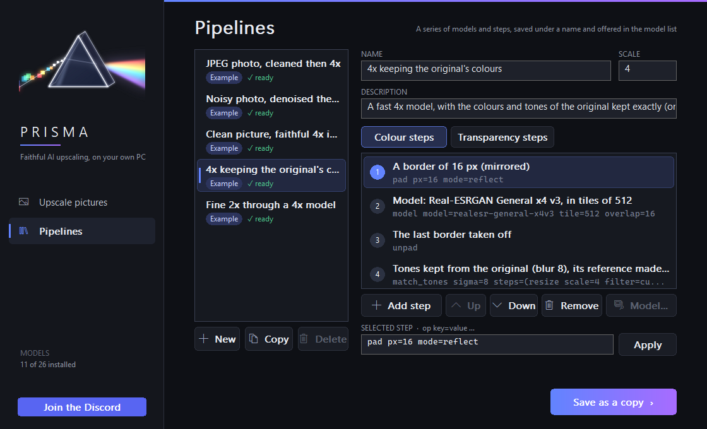

 

**Faithful AI upscaling, on your own PC.**

    

---

**Prisma** remakes your pictures in high definition: four times larger, sharper and cleaner, right on your own
computer. Nothing is uploaded, your pictures never leave your PC.

It shines on **video game assets** like sprites, textures, backgrounds and menus, and works just as well on
**any picture** you want to bring back to life.

## See it

**Game art**

  

**Photos**

  

Left: the small picture given to Prisma. Right: Prisma's best model, 4×. The framed area is shown zoomed below. 
Example pictures by Kenney, Stefan van der Walt and Rachel Michetti, all in the public domain (CC0).

## How it works

Drop in your pictures, pick a model, press **Upscale**. Prisma does everything on your graphics card.

- **Whole folders at once.** Queue as many pictures as you like, stop any time and pick up where you left off.
- **A model for every picture.** Photos, anime, game textures or sprites: pick the one that fits.
- **Or a pipeline of your own.** Chain several models and picture steps, save them under a name, and use the result
  like any model. See [Pipelines](#pipelines) below.
- **Yours, locally.** No cloud, no account, no upload.

 
More than twenty models to choose from, for photos, anime, game textures and sprites, each with its own licence.

## Pipelines

Sometimes one model is not enough: a photo full of compression blocks is best cleaned first, then enlarged; a sprite
with transparency needs its edges handled with care. A **pipeline** is a series of steps you put together once and
reuse: models from the catalog, one after another, with picture steps around them.

1. Open the **Pipelines** page from the side bar.
2. Start from one of the examples (**Copy**) or a blank one (**New**), and give it a name.
3. Add the steps you need with **Add step**, put them in order with **Up** and **Down**, and pick each model step's
   model with **Model...**.
4. Press **Save**. Your pipeline now appears in the model list, under **Pipelines**, ready to be picked like a model.

The steps you can use:

| Step | What it does |
| :-- | :-- |
| **Model** | Any model of the catalog: enlarge, sharpen, denoise, clean up compression |
| **Border** and **Border taken off** | Add a margin around the picture before a model and remove it after, so the edges come out as clean as the middle |
| **Resize** | Bring the picture to a given scale, or to the final size, with the filter of your choice |
| **Enlarged pixel by pixel** | Double or triple the picture first without smoothing, handy for small pixel art |
| **Transparent pixels filled** | Fill the transparent areas from the nearest visible pixels, so no dark fringe appears around sprites |
| **Tones kept from the original** | Keep the original's colours and tones exactly, taking only the fine detail from the models |
| **Grey**, **Levels**, **One channel**, **Clip** | Simple adjustments, mostly for the transparency |

Pictures with transparency can get their own steps on the **Transparency steps** tab; otherwise their transparency
is simply resized with the picture. Prisma comes with a few example pipelines (a JPEG photo cleaned then enlarged, a
noisy photo denoised then enlarged, a faithful 4× in two passes, a 4× that keeps the original's colours, a fine 2×).
The same pipeline on the same picture always gives the same result.

## Download & install

1. Get the latest **`Prisma-x.y.z-win64.zip`** from the [**Releases**](../../releases) page.
2. Unzip it anywhere and run **`Prisma Setup.exe`**.
3. Accept the licence, then let Prisma set itself up.

The first run downloads Prisma's runtime and models from their official sources, each one checked before use.
After that, everything runs from your disk.

## Requirements

| Component | Details |
| :-- | :-- |
| **System** | Windows 10 or 11, 64-bit |
| **Graphics card** | NVIDIA, **4 GB of VRAM** at least 8 GB for the best model |
| **Disk space** | About 12 GB, plus room for your pictures |
| **Internet** | Only once, for the first setup |

## Community

Questions, tips, or something you made with Prisma to show off? Come and say hi.

## Licence

Prisma is **free for personal, non-commercial use**. See [`LICENSE.txt`](LICENSE.txt) for the details.
Prisma is closed source. It builds on open-source software and models, each credited with its own licence in
the licence folder that ships with the application.

Want to use Prisma in a **commercial or paid project**? Reach out on the
**[Discord](https://discord.gg/9uprtBHsaJ)** and we'll sort out a licence.

## Support

If Prisma saves you time, you can support my work on **[GitHub Sponsors](https://github.com/sponsors/MashiroW)**.

 

 
Prisma, made by <strong>Mash</strong>

