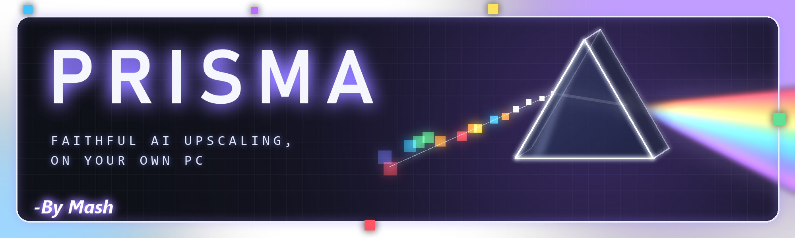
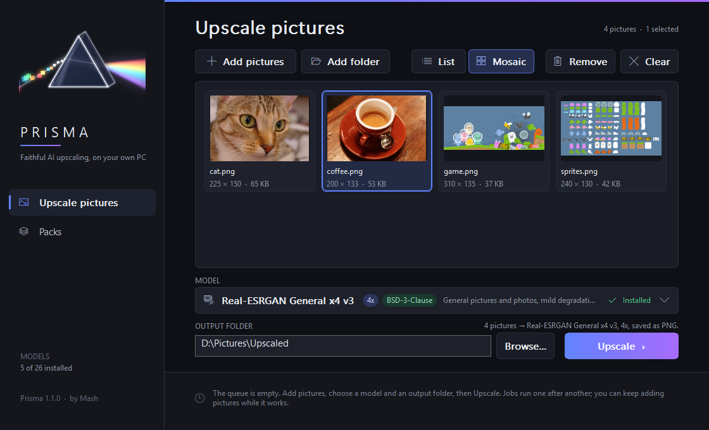
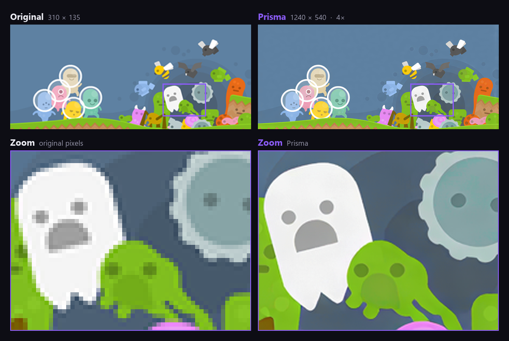
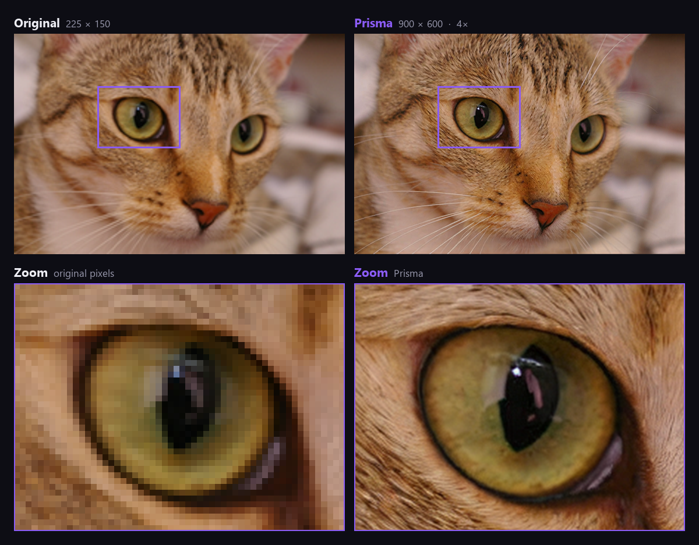
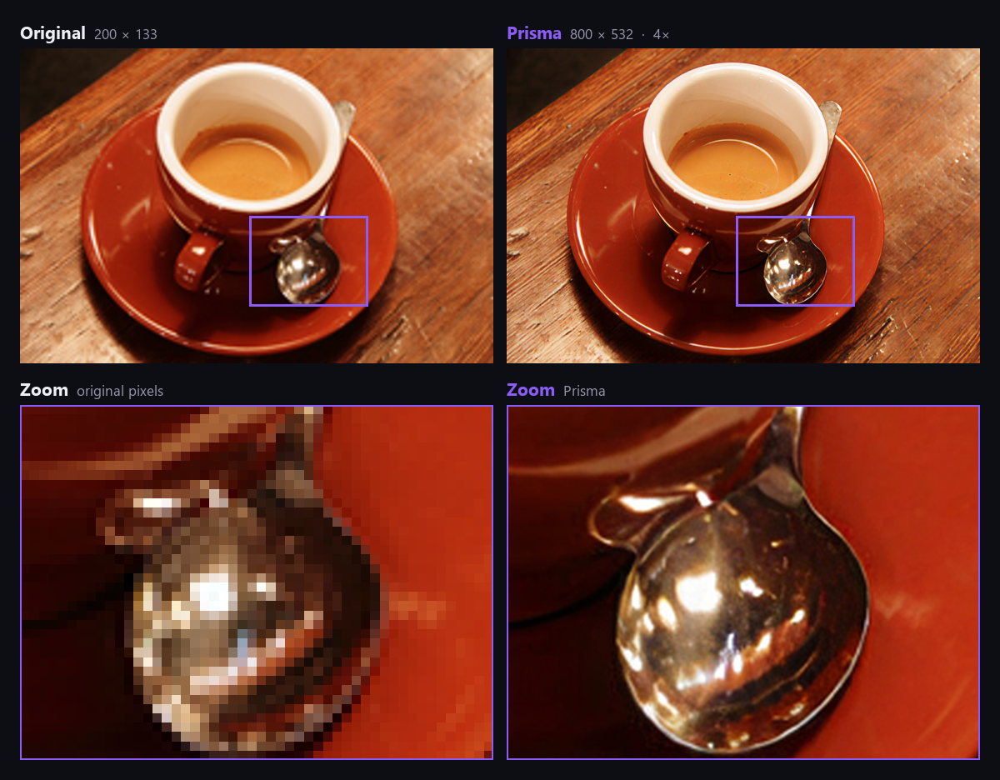
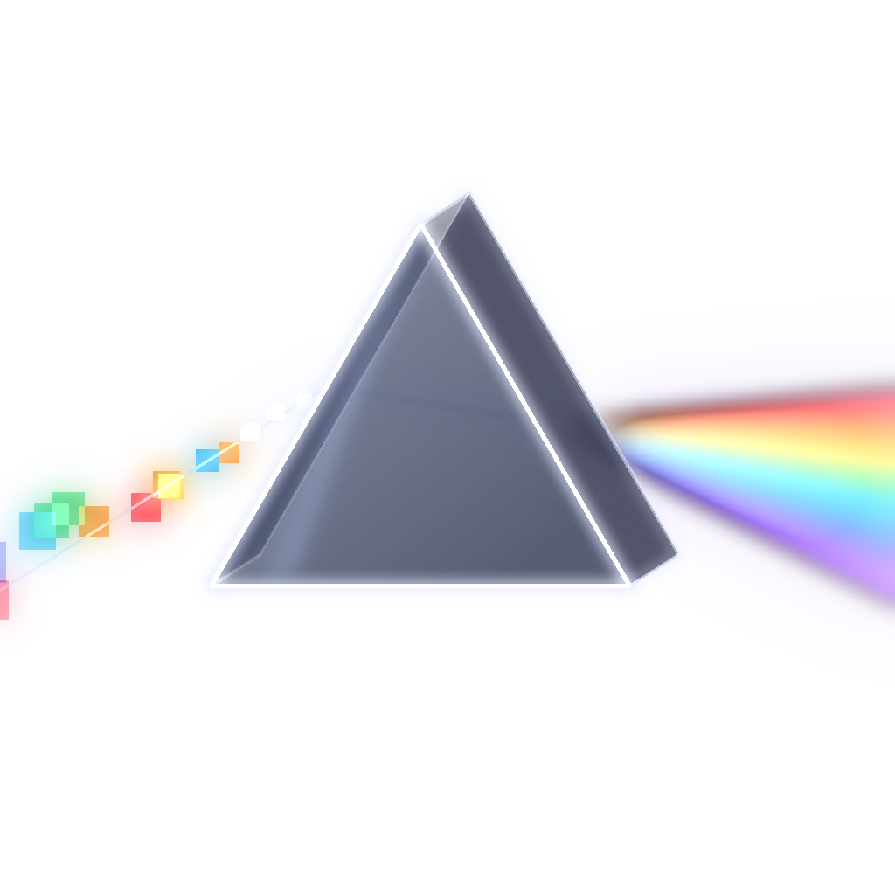
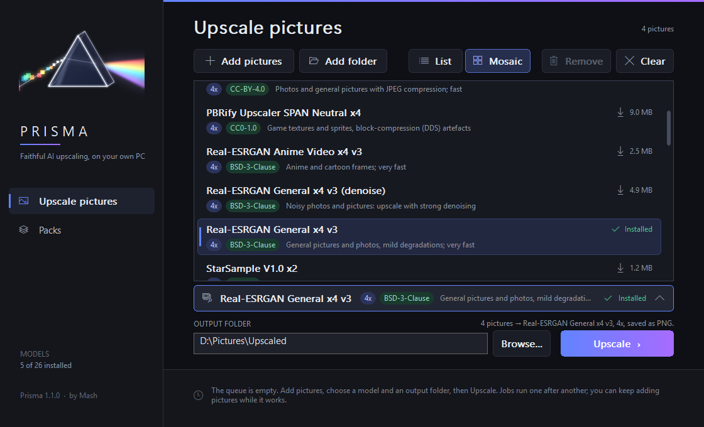
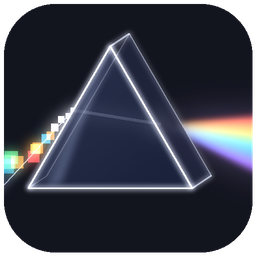

 

**Faithful AI upscaling, on your own PC.**

---

**Prisma** remakes your pictures in high definition — four times larger, sharper and cleaner — right on
your own computer. Nothing is uploaded: your pictures never leave your PC.

It shines on **video game assets** — sprites, textures, backgrounds, menus — and works just as well on
**any picture** you want to bring back to life.

## See it

**Game art**

  

**Photos**

  

Left: the small picture given to Prisma. Right: Prisma's best model, 4×. The framed area is shown zoomed below. 
Example pictures: Kenney, Stefan van der Walt, Rachel Michetti — all in the public domain (CC0).

## How it works

Drop in your pictures, pick a model, press **Upscale**. Prisma runs everything on your graphics card:

- 🎚️ **Fast or Best.** A quick 4× pass for big batches, or the best model for the finest detail.
- 📁 **Whole folders at once.** Queue as many pictures as you like; stop any time and pick up where you
  left off.
- 🧩 **Packs.** A project can ship a pack that tells Prisma exactly how to remake each of its pictures,
  for the same result on every PC.
- 🖥️ **Yours, locally.** No cloud, no account, no upload.

 
More than twenty models to choose from — photos, anime, game textures and sprites — each with its licence.

## Download & install

1. Get the latest **`Prisma-x.y.z.zip`** from the [**Releases**](../../releases) page.
2. Unzip it anywhere and run **`Prisma Setup.exe`**.
3. Accept the licence, then let Prisma set itself up.

The first run downloads Prisma's runtime and models from their official sources, each one checked before
use. After that, everything runs from your disk.

## Requirements

|              |                                                     |
| ------------ | --------------------------------------------------- |
| **System**   | 64-bit Windows 10 or 11                             |
| **Graphics** | An NVIDIA graphics card — 8 GB for the best model   |
| **Disk**     | About 12 GB, plus room for your pictures            |
| **Internet** | Once, for the first setup                           |

## Licence

Prisma is **free for personal, non-commercial use** — see [`LICENSE.txt`](LICENSE.txt). Prisma is closed
source. It builds on open-source software and models, each credited with its own licence in the licence
folder that comes with the application.

 

 
Prisma — by <strong>Mash</strong>

